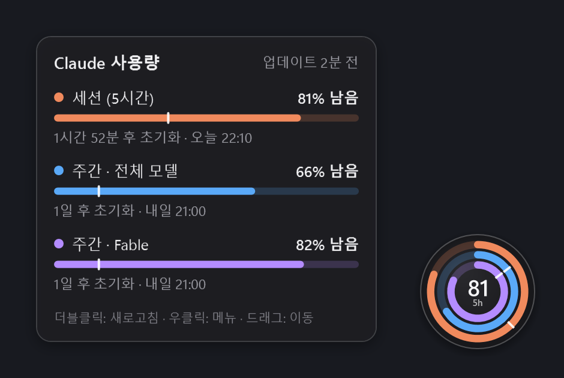
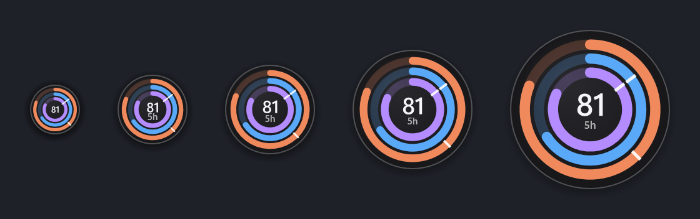
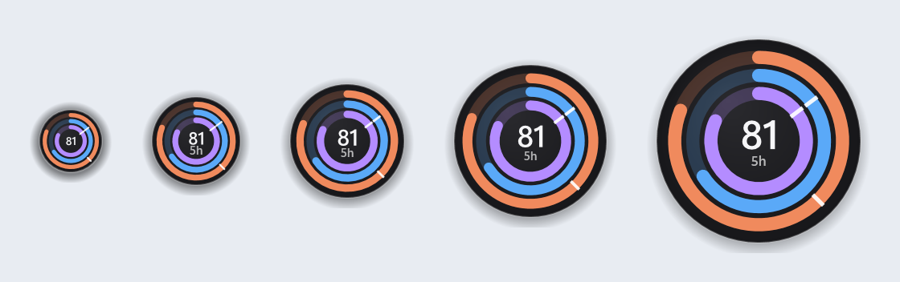

# Claude Usage Orb

**작업 표시줄 옆에 계속 띄워 두는 작은 원형 위젯. Claude 요금제의 남은 사용량을 정확하게 보여 줍니다.**
*A tiny always-on-top orb for Windows that shows how much of your Claude plan you have left. [English below](#english).*



| 다크 배경 | 라이트 배경 |
|---|---|
|  |  |

## 무엇을 보여 주나요

- **바깥 링 (주황)**: 5시간 세션 한도 중 남은 양
- **가운데 링 (파랑)**: 주간 한도 (전체 모델)
- **안쪽 링 (보라)**: 모델별 주간 한도 (예: Fable). 계정에 있을 때만 표시되고 이름은 서버가 내려 주는 대로 씁니다.
- **가운데 숫자**: 5시간 세션의 남은 % (메뉴에서 "가장 적게 남은 한도"로 바꿀 수 있습니다)
- **링 위의 흰 눈금**: 시간 경과 표시선입니다. 링 끝이 눈금보다 앞(시계 방향)에 있으면 시간 대비 여유가 있다는 뜻입니다.
- **마우스를 올리면** 한도별 남은 %, 초기화까지 남은 시간과 시각, "이 속도면 언제 소진되는지" 예측이 나옵니다. 주간 전체 한도 때문에 Fable 같은 모델별 한도를 실제로는 다 못 쓰는 경우도 알려 줍니다.
- **트레이 아이콘**: 같은 숫자를 작은 원으로 보여 주고, 마우스를 올리면 모든 한도를 한 줄로 보여 줍니다.

숫자는 Claude 설정 화면(Settings → Usage)이 쓰는 것과 같은 서버 데이터에서 가져옵니다. 남은 %는 내림해서 표시합니다. 실제로 남아 있는데 0%로 보이는 일은 없습니다(1% 미만이면 `<1`).

## 왜 만들었나 (기존 도구와의 차이)

- **안정성**: 요청이 실패하거나 제한(429)에 걸려도 화면이 비지 않습니다. 마지막 값을 계속 보여 주고 주황 점으로 "오래된 값"이라고 표시합니다. `Retry-After`를 지키면서 점점 길게 기다리고, 절전 해제나 네트워크 복구, 한도 초기화 직후에는 바로 다시 받아 옵니다.
- **로그인 만료 대응**: Claude Code의 로그인 토큰이 만료되면 사용량을 쓰지 않는 `claude auth status`를 실행해 Claude Code가 스스로 갱신하게 합니다. 이 앱은 refresh token을 직접 쓰거나 바꾸지 않습니다. 갱신이 되면 30초 안에 자동으로 다시 연결됩니다.
- **작은 크기**: 40~128px 원 하나가 전부입니다. "작업 표시줄 위에 올리기"를 고르면 작업 표시줄 높이에 맞춰 알림 영역 옆에 붙습니다.
- **작업 표시줄에 가려지지 않음**: 작업 표시줄을 클릭하면 다른 "항상 위" 창은 그 아래로 깔립니다. 이 위젯은 포그라운드가 바뀔 때마다 다시 맨 위로 올라옵니다. 전체 화면 동영상, 게임, 발표 중에는 자동으로 숨습니다.
- **포커스를 뺏지 않음**: 클릭하거나 메뉴를 열어도 지금 쓰던 창의 포커스가 그대로 유지됩니다.
- **가벼움**: .NET 10 WPF 네이티브 앱입니다. 실행 파일은 1MB가 안 되고 PyInstaller나 Electron을 쓰지 않습니다.

## 설치

1. [.NET 10 Desktop Runtime](https://dotnet.microsoft.com/download/dotnet/10.0)이 필요합니다(Windows 10/11 x64). 이미 설치돼 있을 수 있습니다.
2. [Releases](../../releases)에서 `ClaudeUsageOrb.exe`를 받아 원하는 폴더(예: `%LOCALAPPDATA%\Programs\ClaudeUsageOrb`)에 두고 실행합니다. 런타임을 설치하기 싫다면 `ClaudeUsageOrb-selfcontained.exe`를 받으세요.
3. 이 PC에서 **Claude Code에 로그인**돼 있어야 합니다(`claude` 실행 후 `/login`). 위젯은 Claude Code가 저장한 로그인 정보(`%USERPROFILE%\.claude\.credentials.json`, 또는 `CLAUDE_CONFIG_DIR`)를 읽기만 합니다.
4. 우클릭 메뉴에서 **Windows 시작 시 실행**을 켜 두면 됩니다.

> Windows 11은 새 트레이 아이콘을 숨김 영역(^) 안에 넣습니다. 우클릭 메뉴의 **트레이 아이콘 항상 표시**를 누르거나, 설정 → 개인 설정 → 작업 표시줄 → 기타 시스템 트레이 아이콘에서 켜면 작업 표시줄에 항상 보입니다.

## 조작

| 동작 | 결과 |
|---|---|
| 마우스 올리기 | 상세 카드 |
| 더블클릭 | 지금 새로고침 |
| 드래그 | 이동 (화면 가장자리에 자석처럼 붙고, 작업 표시줄 위에 놓으면 높이를 맞춰 가운데 정렬) |
| 우클릭 | 메뉴: 크기, 투명도, 가운데 숫자, 새로고침 주기, 항상 위, 전체 화면일 때 숨기기, 위치 잠금, 클릭 통과, 작업 표시줄에 올리기, 시작 프로그램, 언어 |
| 트레이 아이콘 클릭 | 위젯 보이기/숨기기 |
| 트레이 아이콘 우클릭 | 같은 메뉴 (클릭 통과를 켰을 때 해제하는 곳) |

설정과 로그는 `%APPDATA%\ClaudeUsageOrb`에 저장됩니다(메뉴 → 설정 · 로그 폴더 열기). 로그에는 토큰이나 계정 정보를 남기지 않습니다.

## 데이터와 개인정보

- 통신하는 곳은 `https://api.anthropic.com/api/oauth/usage` 하나뿐이고, Claude Code의 access token을 `Authorization` 헤더로 보냅니다. 다른 서버로는 아무것도 보내지 않습니다.
- 모델을 호출하지 않으므로 **사용량을 소모하지 않습니다.**
- 이 엔드포인트는 공식 문서가 없는 내부 API라 언젠가 바뀔 수 있습니다. 응답 형식이 바뀌어도 알려진 필드가 있으면 계속 동작하도록 만들었고, 새로운 종류의 한도는 자동으로 링과 카드에 추가됩니다.
- Anthropic과 관련 없는 비공식 커뮤니티 프로젝트입니다.

## 직접 빌드

```powershell
# .NET 10 SDK 필요
.\tools\build.ps1 -Run        # 빌드 후 실행
.\tools\build.ps1 -Publish    # dist\ClaudeUsageOrb.exe (단일 파일)
dotnet test ClaudeUsageOrb.slnx
```

`ClaudeUsageOrb.exe --preview <폴더>`는 마지막으로 받은 데이터로 위젯과 카드를 PNG로 그립니다(README 스크린샷용).

---

## English

A small, always-on-top, non-activating orb for Windows 10/11 that shows your **remaining** Claude plan usage: one ring per limit (5-hour session, weekly all-models, and per-model weekly limits such as Fable). The center shows the session's remaining %. Hover for a card with reset times and a burn-rate projection.

- Reads the Claude Code OAuth login from `~/.claude/.credentials.json` and calls only `api.anthropic.com/api/oauth/usage`. It uses no model tokens, never touches the refresh token, and logs no secrets.
- Keeps showing the last good values on errors, honors `Retry-After`, backs off on 429, and refreshes after sleep/resume, after network recovery and right after a window resets.
- When the token has expired it runs `claude auth status` so Claude Code can renew it, and reconnects within 30 s.
- Stays above the taskbar (re-asserts z-order on every foreground change), can dock onto the taskbar, and hides while a full-screen app runs.
- Tray icon with the same number. Korean and English UI.

Requires the .NET 10 Desktop Runtime (or use the self-contained build). MIT licensed. Not affiliated with Anthropic.
